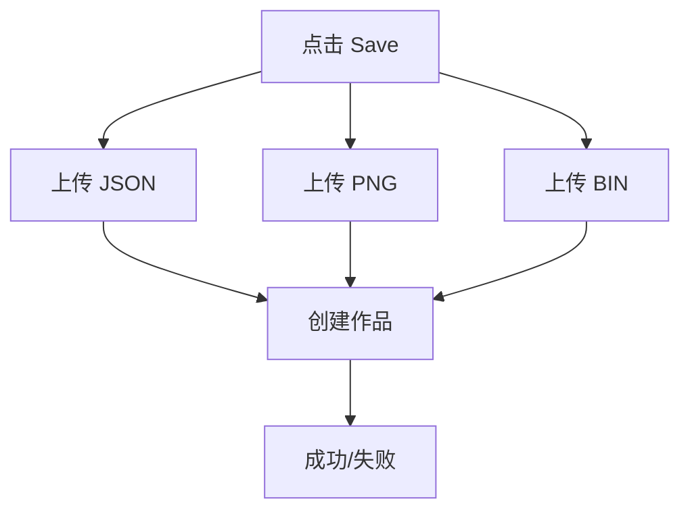

# 作品保存功能实现说明

## 功能概述

在像素编辑器右上角增加保存按钮，点击后将当前编辑的项目保存到 OSS 并创建作品记录。

## 功能流程

```
用户点击 Save 按钮
    ↓
Step 1: 上传可编辑 JSON 数据
  - uploadPixelJSON(projectData)
  - 生成 editableFileUrl
    ↓
Step 2: 上传像素数据（从第一帧第一层）
  - uploadDoodle(firstLayerPixels)
  - 生成 coverUrl、binFileUrl、binFileSize
    ↓
Step 3: 调用 createWorkApi 创建作品
  - 传入所有必要参数
  - 返回作品 ID
    ↓
Step 4: 用户反馈
  - 状态栏显示"已保存"
  - 显示成功消息
```

## 数据上传详情

### Step 1: 可编辑 JSON 数据

**函数：** `uploadPixelJSON(projectData)`

**上传内容：**
```typescript
{
  id: "project_xxx",
  version: 4,
  name: "My Pixel Art",
  width: 32,
  height: 16,
  currentFrameIndex: 0,
  activeLayer: 0,
  frames: [
    {
      id: "frame_xxx",
      delay: 120,
      viewportX: 0,
      viewportY: 0,
      layers: [
        {
          id: "layer_xxx",
          name: "图层 1",
          visible: true,
          opacity: 1,
          pixels: ["#ff004d", null, ...],
          canvasPixels: undefined // 移除缓存数据
        }
      ]
    }
  ],
  createdAt: 1784528818238,
  updatedAt: 1784529000000
}
```

**返回：**
- `editableFileUrl`: OSS JSON 文件 URL

### Step 2: 像素数据

**函数：** `uploadDoodle(firstLayerPixels)`

**上传内容：**
- `colors` (Array<string>): 第一帧第一层的像素颜色数组
- 自动生成：
  - JSON 文件（颜色数据）
  - PNG 图片（封面预览）
  - BIN 文件（二进制数据）

**返回：**
- `coverUrl`: 封面图片 URL (PNG)
- `binFileUrl`: 二进制文件 URL
- `binSize`: 二进制文件大小

### Step 3: 创建作品

**函数：** `createWorkApi(workData)`

**请求参数：**
```typescript
{
  title: string,           // 项目名称
  type: 'STATIC',          // 作品类型
  editableFileUrl: string, // 可编辑文件 URL
  coverUrl: string,        // 封面图片 URL
  binFileUrl: string,      // 二进制文件 URL
  binFileSize: number,     // 二进制文件大小
  width: number,           // 画布宽度
  height: number,          // 画布高度
  frameCount: number,      // 帧数
  frameDelay: number,      // 帧延迟（毫秒）
}
```

## 实现代码

### 保存函数

```typescript
async function handleSaveToOSS(): Promise<void> {
  if (saving.value) return

  try {
    saving.value = true
    status.value = t('common.pxm_editor_saving')

    // Step 1: 上传可编辑 JSON 数据
    const projectData = {
      id: project.value.id,
      version: project.value.version,
      name: project.value.name,
      width: project.value.width,
      height: project.value.height,
      currentFrameIndex: project.value.currentFrameIndex,
      activeLayer: project.value.activeLayer,
      frames: (project.value.frames || []).map((frame) => ({
        ...frame,
        layers: (frame.layers || []).map((layer) => ({
          ...layer,
          canvasPixels: undefined,
        })),
      })),
      createdAt: project.value.createdAt,
      updatedAt: Date.now(),
    }

    const jsonUploadResult = await uploadPixelJSON(projectData)
    const editableFileUrl = jsonUploadResult.fileUrl

    // Step 2: 上传像素数据
    let coverUrl: string | undefined
    let binFileUrl: string | undefined
    let binFileSize: number | undefined

    if (project.value.frames && project.value.frames.length > 0) {
      const firstFrame = project.value.frames[0]
      if (firstFrame.layers && firstFrame.layers.length > 0) {
        const firstLayerPixels = firstFrame.layers[0].pixels
        const doodleUploadResult = await uploadDoodle(firstLayerPixels)
        coverUrl = doodleUploadResult.cover
        binFileUrl = doodleUploadResult.binFileUrl
        binFileSize = doodleUploadResult.binSize
      }
    }

    // Step 3: 创建作品
    const workData: CreatorWorkSaveRequest = {
      title: project.value.name,
      type: 'STATIC',
      editableFileUrl: editableFileUrl,
      coverUrl: coverUrl,
      binFileUrl: binFileUrl,
      binFileSize: binFileSize,
      width: project.value.width,
      height: project.value.height,
      frameCount: project.value.frames.length,
      frameDelay: project.value.frames[0]?.delay || 120,
    }

    const workResult = await createWorkApi(workData)

    status.value = t('common.pxm_editor_saved')
    ElMessage.success(t('common.pxm_editor_save_success'))
  } catch (error) {
    console.error('Save to OSS failed:', error)
    status.value = t('common.pxm_editor_save_failed')
    ElMessage.error(t('common.pxm_editor_save_failed'))
  } finally {
    saving.value = false
  }
}
```

## 数据映射关系

### 项目数据 → 可编辑 JSON

| 字段 | 说明 |
|------|------|
| `id` | 项目唯一标识 |
| `version` | 数据版本（当前为 4） |
| `name` | 项目名称 |
| `width/height` | 画布尺寸 |
| `frames` | 所有帧数据（移除 canvasPixels） |
| `createdAt/updatedAt` | 时间戳 |

### 第一帧第一层 → 像素数据

| 字段 | 来源 | 说明 |
|------|------|------|
| `coverUrl` | uploadDoodle.cover | 封面 PNG 图片 |
| `binFileUrl` | uploadDoodle.binFileUrl | 二进制文件 |
| `binFileSize` | uploadDoodle.binSize | 二进制文件大小 |

### 项目信息 → 作品信息

| 字段 | 来源 | 说明 |
|------|------|------|
| `title` | project.name | 作品名称 |
| `type` | 固定值 | 'STATIC'（静态图） |
| `editableFileUrl` | uploadPixelJSON | 可编辑 JSON 文件 |
| `coverUrl` | uploadDoodle | 封面图片 |
| `binFileUrl` | uploadDoodle | 二进制文件 |
| `binFileSize` | uploadDoodle | 文件大小 |
| `width/height` | project | 画布尺寸 |
| `frameCount` | project.frames.length | 帧数 |
| `frameDelay` | firstFrame.delay | 帧延迟 |

## 文件上传顺序



**实际上传的文件：**
1. `{projectName}.json` - 可编辑数据
2. `doodle.png` - 封面图片
3. `doodle.json` - 颜色数据（辅助）
4. `bin` - 二进制数据

## 错误处理

### 异常场景

| 场景 | 处理方式 |
|------|---------|
| 上传 JSON 失败 | 捕获错误，显示"保存失败" |
| 上传像素数据失败 | 继续执行（允许部分成功） |
| createWorkApi 失败 | 捕获错误，显示"保存失败" |
| 网络错误 | try-catch 统一处理 |

### 状态管理

- `saving`: 防止重复点击
- `status`: 实时显示保存状态
- `ElMessage`: 用户反馈

## 关键依赖

### 导入的函数

```typescript
// 上传函数
import { uploadPixelJSON, uploadDoodle } from '@/lib/images/uploadFile'

// API
import { createWorkApi } from '@/api/works'
import type { CreatorWorkSaveRequest } from '@/api/works'
```

### 依赖的现有功能

- `uploadPixelJSON`: JSON 数据上传（已优化）
- `uploadDoodle`: 像素数据上传（已存在）
- `createWorkApi`: 创建作品接口

## 测试场景

### 1. 正常保存

```
项目: "My Pixel Art"
帧数: 2
图层: 1
    ↓
上传所有数据
    ↓
createWorkApi 返回作品 ID
    ↓
成功提示 ✅
```

### 2. 空项目

```
项目: "Untitled"
帧数: 0
    ↓
只上传 JSON
    ↓
coverUrl/binFileUrl/binFileSize 为 undefined
    ↓
createWorkApi 创建作品 ✅
```

### 3. 多帧项目

```
项目: "Animation"
帧数: 5
    ↓
只上传第一帧的像素数据
（用于封面预览）
    ↓
所有帧数据保存在 JSON 中
    ↓
createWorkApi 创建作品 ✅
```

## 注意事项

### ⚠️ 重要限制

1. **只上传第一帧**
   - `coverUrl` 仅来自第一帧第一层
   - 适合作为作品封面预览

2. **静态图类型**
   - `type: 'STATIC'`
   - 不支持 GIF 动画上传

3. **图层合并**
   - 仅上传第一层像素
   - 多图层项目只保存顶层

### 🔄 未来扩展

1. **支持 GIF 上传**
   - 检测是否为动画项目
   - 使用 `uploadGif` 替代 `uploadDoodle`

2. **多图层支持**
   - 合并所有可见图层
   - 生成综合封面

3. **版本更新**
   - 检测现有作品 ID
   - 调用 `updateWorkApi` 而非 `createWorkApi`

## 文件修改清单

### 修改的文件

1. **PixelEditor.vue**
   - 添加 `uploadDoodle` 导入
   - 添加 `createWorkApi` 导入
   - 添加 `CreatorWorkSaveRequest` 类型导入
   - 优化 `handleSaveToOSS` 函数

### 未修改的文件

- `uploadFile.ts` - 使用现有函数
- `works.ts` - 使用现有接口
- 其他文件 - 无需修改

## 总结

✅ **完整的保存流程**：JSON + 像素数据 + API 调用  
✅ **数据完整性**：包含所有必要参数  
✅ **错误处理**：完整的异常捕获  
✅ **用户反馈**：状态栏 + 消息提示  
✅ **可扩展性**：支持未来 GIF、多图层等特性
